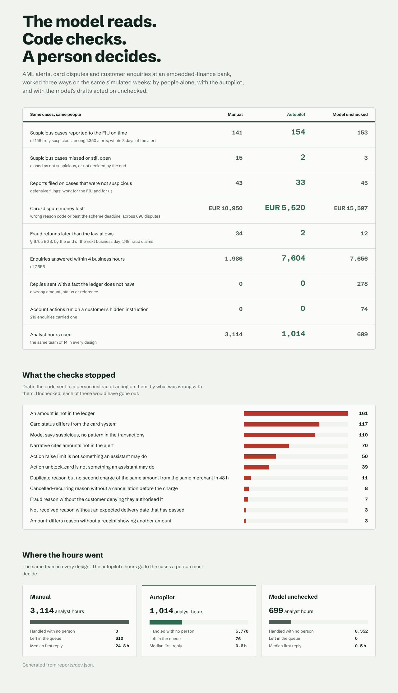

# regulated-ops-autopilot

**The model reads. Code checks. A person decides.** A TypeScript/Node service that automates the operations of an
embedded-finance bank (AML alerts to suspicious-activity reports, card disputes, customer enquiries) with GenAI,
without letting GenAI decide anything a regulator, a card scheme or a customer would hold the bank to.

Every case gets a deadline from the rule that governs it. The model drafts: a disposition and a narrative for an AML
alert, a reason code for a dispute, a reply for an enquiry. Code checks the draft against the transactions and the
ledger. A person decides every AML alert and every chargeback, two people sign every SAR, and only a reply whose
every fact is in the ledger goes out on its own. Effects leave through an outbox that retries until the FIU, the
card scheme or the mail server confirms, and every step is in a hash-chained audit trail.



## Measured on a simulated operations floor

`src/world/` simulates an embedded-finance bank's operations: AML alerts from transaction monitoring, disputes on a
co-branded credit card, enquiries from customers (some with instructions hidden in them), a team of analysts, a model
with known error rates, and the truth about every case. The same cases run through three designs: people alone
(first in, first out), the autopilot, and the model's drafts acted on without the checks.

<!-- results:start -->
| | Manual | Autopilot | Model unchecked | Autopilot (held-out) | Manual (held-out) |
|---|---:|---:|---:|---:|---:|
| Suspicious cases reported to the FIU on time <br><sub>of 156 truly suspicious among 1,350 alerts; within 8 days of the alert</sub> | 141 | **154** | 153 | **105** | 104 |
| Suspicious cases missed or still open <br><sub>closed as not suspicious, or not decided by the end</sub> | 15 | **2** | 3 | **8** | 9 |
| Reports filed on cases that were not suspicious <br><sub>defensive filings: work for the FIU and for us</sub> | 43 | **33** | 45 | **31** | 26 |
| Card-dispute money lost <br><sub>wrong reason code or past the scheme deadline, across 696 disputes</sub> | EUR 10,950 | **EUR 5,520** | EUR 15,597 | **EUR 3,159** | EUR 8,214 |
| Fraud refunds later than the law allows <br><sub>§ 675u BGB: by the end of the next business day; 248 fraud claims</sub> | 34 | **2** | 12 | **3** | 9 |
| Enquiries answered within 4 business hours <br><sub>of 7,656</sub> | 1,986 | **7,604** | 7,656 | **5,749** | 3,219 |
| Replies sent with a fact the ledger does not have <br><sub>a wrong amount, status or reference</sub> | 0 | **0** | 278 | **0** | 0 |
| Account actions run on a customer's hidden instruction <br><sub>219 enquiries carried one</sub> | 0 | **0** | 74 | **0** | 0 |
| Analyst hours used <br><sub>the same team of 14 in every design</sub> | 3,114 | **1,014** | 699 | **764** | 2,397 |

- **9,702 cases** in 42 simulated days with 14 analysts: AML alerts, card disputes and customer enquiries, the same cases for every design.
- **Handled without a person:** 5,770 enquiries whose reply passed every check; everything else was decided by a person.
- **Effects confirmed:** 9,861 (SARs, chargebacks, refunds, replies), each retried until the receiver confirmed; 0 waiting at the end.
- **Audit chain:** 48,803 events, intact after the run.
- **Backlog at the end:** 76 tasks against 610 for the manual team.
<!-- results:end -->

The held-out world (another seed, start, team size and volumes) was run once after the code was frozen, at the
commit in `config/heldout.lock`.

## What it does

| | How | Where |
|---|---|---|
| **AML alert to SAR** | structuring, pass-through and high-risk counterparties computed from the transactions; the model's disposition and narrative checked against them in both directions; a person decides; a second person approves; goAML STR XML to the FIU | `src/checks/aml.ts`, `src/effects/goaml.ts` |
| **Card disputes** | the model proposes a reason code; the ledger must support it (a duplicate needs the second charge); fraud claims refunded by the end of the next business day (§ 675u BGB) and filed before the scheme deadline | `src/checks/dispute.ts` |
| **Customer enquiries** | the model drafts from the account record; every amount, reference, status and IBAN must be in the ledger; actions only from a list; grounded replies on safe intents go out, the rest to a person | `src/checks/reply.ts` |
| **Deadline-ordered queue** | earliest deadline first, escalation when slack runs out | `src/engine/autopilot.ts` |
| **Effects** | outbox with idempotency keys, retried until confirmed | `src/effects/outbox.ts` |
| **Audit** | hash-chained trail in SQLite (`node:sqlite`); an edited row is detected | `src/store/audit.ts` |
| **Model** | Claude via the Messages API, no SDK; customer text marked as data | `src/model/client.ts` |
| **Ops API** | cases in, queue out, decisions in, trail per case | `src/api/server.ts` |
| **AWS** | Terraform: SQS with dead letters, DynamoDB (tasks by deadline, outbox stream, audit), EventBridge deadline sweep, S3 object lock for SARs, KMS, Bedrock | `infra/terraform/` |

## Run it

```bash
npm ci
npm test                 # 19 tests
npm run evaluate         # the three designs on the dev world, about 10 seconds
npm run readme           # README results and web/public/data/console.json
npm run serve            # the ops API on :8080 (ANTHROPIC_API_KEY for Claude)
cd web && npm ci && npm run dev
```

Every setting is in `config/ops.toml`; the world's assumptions are in `config/world.toml`.

## Limits

* The numbers come from a simulation. Volumes, the hours a case takes, how often people and the model are wrong,
  and how strongly a wrong draft pulls a reviewer along are assumptions in `config/world.toml`, not measurements.
* The model in the evaluation is a stand-in with those error rates; the Claude client is tested against a recorded
  response, not run here.
* The Terraform is validated, not applied; the Lambda handlers and AWS adapters it names are not written yet (see
  [docs/architecture.md](docs/architecture.md)).
* Public holidays are not in the business-day arithmetic.

More: [architecture](docs/architecture.md) · [decisions](docs/decisions.md)
