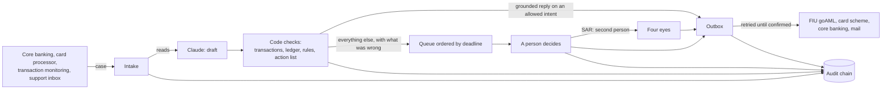

# Architecture

| Piece | Where | What it guarantees |
|---|---|---|
| Intake | `src/engine/autopilot.ts` | every case gets a deadline from the rule that applies (decision days for AML, scheme and § 675u BGB for disputes, business hours for replies) |
| Model | `src/model/client.ts` | a draft in JSON; customer text marked as data; Claude via the Messages API (Bedrock in the Terraform) |
| Checks | `src/checks/` | AML patterns computed from the transactions; a narrative cites only real amounts; a dispute reason only if the ledger supports it; a reply states only ledger facts and requests only listed actions |
| Queue | `Autopilot.ordered` | earliest deadline first, escalation when the time left minus the work left falls under the slack |
| Outbox | `src/effects/outbox.ts` | one effect per case and kind, retried until confirmed |
| goAML | `src/effects/goaml.ts` | STR reports built from facts, XML-escaped |
| Audit | `src/store/audit.ts` | hash chain in SQLite; an edited row is found |
| API | `src/api/server.ts` | cases in, the ordered queue out, a person's decision in, the trail per case |

## AWS (infra/terraform)

SQS for incoming cases with a dead-letter queue and an alarm on it; DynamoDB for tasks (indexed by deadline), the
outbox (its stream drives the sender) and the audit trail; an EventBridge rule every 15 minutes for the deadline
sweep; S3 with object lock in compliance mode for five years of SARs; one KMS key; Bedrock for the model.

## What is built and what is not

Built and tested: everything in `src/`, run as a Node service (`npm run serve`) and in the simulation. The
Terraform is the target AWS layout and passes `terraform validate` in CI; it has not been applied, and the Lambda
handlers and DynamoDB/Bedrock adapters it names are the next step. The core-banking, card-processor and FIU
connections are interfaces (`Systems`, `Transport`) with the simulated world behind them.
